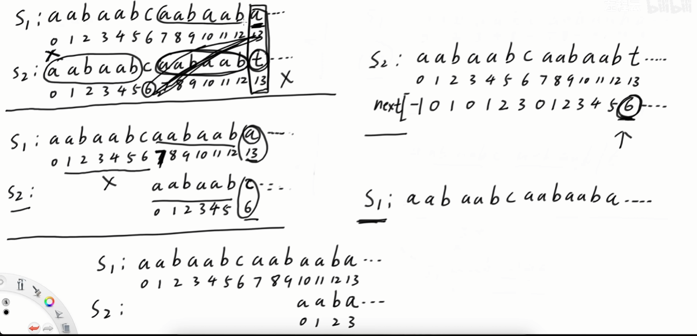

## 串的定义与实现

字符串简称串，由零个或多个字符组成的有限序列

### 定长顺序存储

采用一组连续的存储单元来存储串值的字符序列

```cpp
typedef struct
{
    char ch[MAXSIZE];
    int length;
} SString;
```

### 堆分配存储

```cpp
typedef struct
{
    char *ch;//按串长分配存储区，ch指向串的基地址
    int length;
} HString;
```

在堆空间内申请存储空间
### 块链存储表示

采用链表的方式存储串值，在具体实现时，每个结点可以存放一个或多个字符，每个结点被称为块，整个链表成为块链结构

## 串的模式匹配

### 简单的模式匹配算法

字串的定位操作被称为串的模式匹配，求字串在主串的位置。

```cpp
int index(HString *S, HString *T)
{
    int i = 0, j = 0;
    while (i < S->length && j < T->length)
    {
        if (S->ch[i] == T->ch[j])
        {
            i++;
            j++;
        }
        else
        {
            i = i - j + 1;
            j = 0;
        }
    }
    if (j >= T->length)
    {
        return i - T->length;
    }
    else
    {
        return 0;
    }
}
```

### 串模式匹配算法——KMP算法

[KMP算法](https://cwdpsky.top/KPM%E7%AE%97%E6%B3%95/)

有部分匹配上的情况下说明大串的前后缀和小串的部分前缀相同，当发现不匹配的时候，大串下标不动，将小串原本下标为`i`的修改为下标`next[i]`与大串进行匹配即可




```cpp
//时间复杂度为O(n)
public static int kmp(char[] s1, char[] s2){
    int n = s1.length, m = s2.length,x = 0, y = 0;
    int[] next = nextArray(s2, m);
    while (x < n && y < m){
        if (s1[x] == s2[y]){
            x++;
            y++;
        }
        else if (y == 0){//①开头不匹配；②中间过程从头开始匹配。即y=next[y]=0,且两个不同
            x++;
        }
        else {
            y = next[y];//x位置转为与next[y]来进行比对
        }
    }
    return y == m ? x - y : -1;
}
//复杂度为O(m)
public static int[] nextArray(char[] s,int m){
    if(m == 1){
        return new int[] {-1};
    }
    int[] next new int[m];
    next[0] = -1;
    next[1] = 0;
    int i = 2, cn = 0;//cn为前一个字符串的next值，也就是前一个字符串要和谁比较
    while (i < m){
        if (s[i - 1] == s[cn]){
            next[i++] = ++cn;
        }
        else if (cn > 0){
            cn = next[cn];
        }
        else {
            next [i++] = 0;
        }
    }
    return next;
}
```

#### next数组的优化

核心思想：

当S2的字符串在回退的时候出现`S2[next[y]] == S2[y]`，即当前判断的字符与回退的字符相同，那就意味着回退后的字符也要继续回退，那就不需要在做一次对比了，让它接着回退到，直到是不一样的字符

因此在计算`nextval`数组的时候，在`next`数组的基础上，多一步对各个字符`S2[next[i]] == S2[i]`的判断

|         |     |     |     |     |     |     |
| ------- | --- | --- | --- | --- | --- | --- |
| 字符串     | a   | a   | b   | a   | a   | b   |
| 下标      | 0   | 1   | 2   | 3   | 4   | 5   |
| next    | -1  | 0   | 1   | 0   | 1   | 2   |
| nextval | -1  | -1  | 1   | -1  | -1  | 1   |

