转置，伴随，逆的计算顺序可交换
$|AB|=|B||A|$
## 矩阵转置

$(A+B)^{T}=A^{T}+B^{T}$
$(AB)^{T}=B^{T}A^{T}$
$|A^{T}|=|A|$
## 矩阵伴随

矩阵的转置，求逆，伴随的运算次序可交换

$A\cdot A^{*}=|A|E$
$A^{*}=|A|A^{-1}$
$|A^{*}|=|A|^{n-1}$
$(AB)^{*}=B^{*}A^{*}$

当$A_{ij}=a_{ij}$，意味着$A^{*}=A^{T}$，两边同时取行列式，有$|A|^{n-1}=|A^{T}|$，判断是否满秩，满秩则$|A|=1$，同时$A$为正交矩阵
## 逆矩阵

$(AB)^{-1}=B^{-1}A^{-1}$
$(kA)^{-1}=\frac{1}{k}A^{-1}$
$|A^{-1}|=\frac{1}{|A|}$
### 求解逆矩阵

#### 具体矩阵

$A^{*}=|A|A^{-1}$，二阶

$[A\vdots E]\to[E\vdots A]$,初等行变换，三阶用

#### 抽象矩阵

创造$AB=E$，则$A^{-1}=B$

创造$A=BC$，若$B,C$均可逆，则$A^{-1}=C^{-1}B^{-1}$

## 正交矩阵

$AA^{T}=E$，则$A$为正交矩阵，每行每列都是单位向量，且行列都相互正交，$A^{T},A^{-1},A^{*}$仍然是正交矩阵

若$A,B$为同阶正交矩阵，则$AB$为正交矩阵

正交矩阵的行列式为1或-1
## 初等矩阵

初等矩阵：单位矩阵经过一次初等变换所得的矩阵，称为初等矩阵

初等变换：两行/列交换$E_{ij}$，某行/列乘以某个数$E_{i}(k)$，某行/列乘以某个数加到另一行/列$E_{ij}(c)$

矩阵左乘一个初等矩阵相当于对矩阵做了一次与初等矩阵相同的初等行变换

矩阵右乘一个初等矩阵相当于对矩阵做了一次与初等矩阵相同的初等列变换

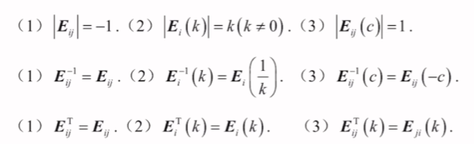

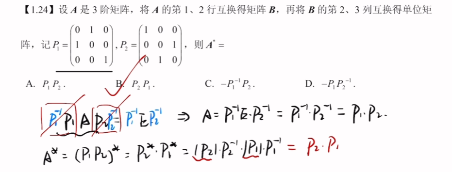

矩阵等价=>$r(A)=r(B)$，即两个矩阵能不能通过初等行变换和初等列变换相互得到
## 矩阵的秩

矩阵的秩不可能超过行数和列数

$r(kA)=r(A)(r\neq0)$

$r(A)=r(PA)=r(AQ)=r(PAQ)，P、Q$均可逆

$r(AB)\leq min\{r(A),r(B)\}$
>秩越乘越小

===$A_{m×n}B_{n×l}=O\to r(A)+r(B)\leq n$===

$r(A+B)\leq r([A,B])\leq r(A)+r(B)$

$r(AB)\geq r(A)+r(B)-n$
$$
r(A^{*})=
\begin{cases}
	n,r(A)=n \\
	1,r(A)=n-1 \\
	0,r(A)<n-1
\end{cases}
$$

$r(A)=r(A^{T})=r(AA^{T})=r(A^{T}A)$

若$A^{2}=A$，则$r(A)+r(A-E)=n$
>$A(E-A)=O,r(A)+r(E-A)\leq n,r(A)+r(E-A)\geq r(A+E-A)=n$

若$A^{2}=E$，则$r(A+E)+r(A-E)=n$
$Ax=0$的基础解系所含向量的个数$s=n-r(A)$

$$ \begin{cases} r\left(\begin{bmatrix} A & O \\ O & B \end{bmatrix}\right) = r(A)+r(B) \\[1em] r\left(\begin{bmatrix} A & O \\ C & B \end{bmatrix}\right) \ge r(A)+r(B),\ A\text{可逆时取等号} \end{cases} $$

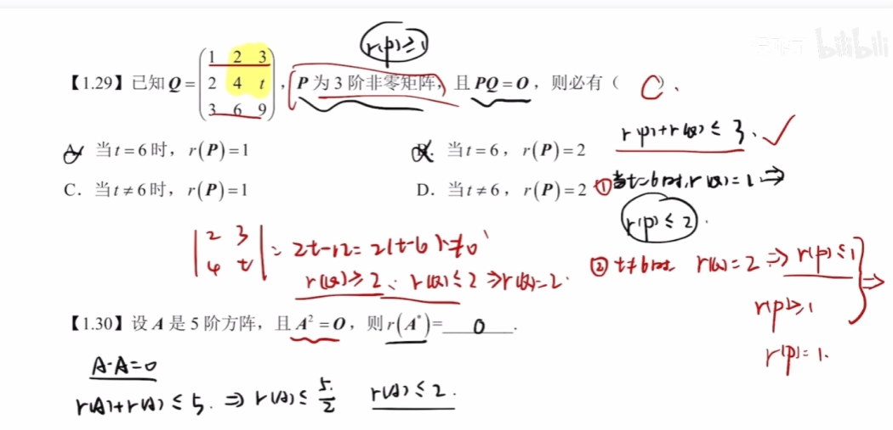

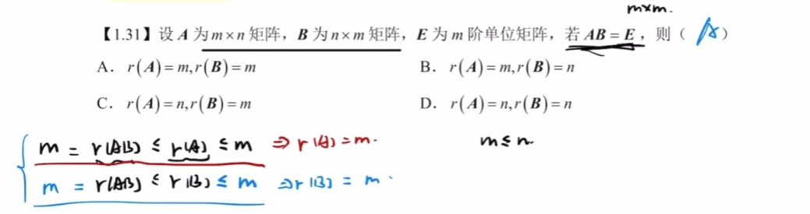

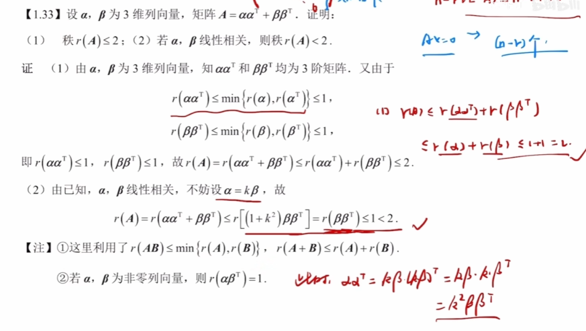

矩阵等价=>$r(A)=r(B)$
> 反推不能，同型矩阵时可反推

$P,Q$为可逆阵=>$r(PAQ)=r(A)$
> 视作对$A$进行了一系列行列变换

已知$A_{m×n}B_{n×l}=C$，且$r(A)=n$，则$r(B)=r(C)$
> 矩阵$A$为列满秩矩阵，通过行变换可以转变为上面为$E$，下面为0的矩阵，与$B$相乘则为上面为$B$，下面为0的矩阵，左侧矩阵的秩取决于$B$,因此$r(B)=r(C)$

列满秩阵右乘某矩阵,所得矩阵的秩=某矩阵的秩

## 分块矩阵

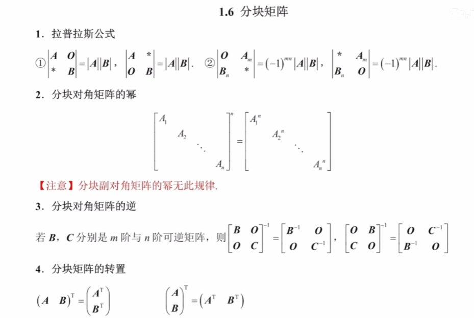
分块矩阵的伴随=分块矩阵的逆×分块矩阵的行列式

$$ \begin{cases} r\left(\begin{bmatrix} A & O \\ O & B \end{bmatrix}\right) = r(A)+r(B) \\[1em] r\left(\begin{bmatrix} A & O \\ C & B \end{bmatrix}\right) \ge r(A)+r(B),\ A\text{可逆时取等号} \end{cases} $$
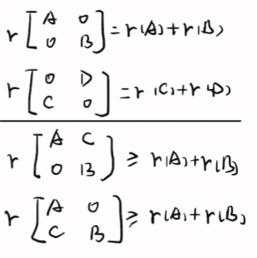
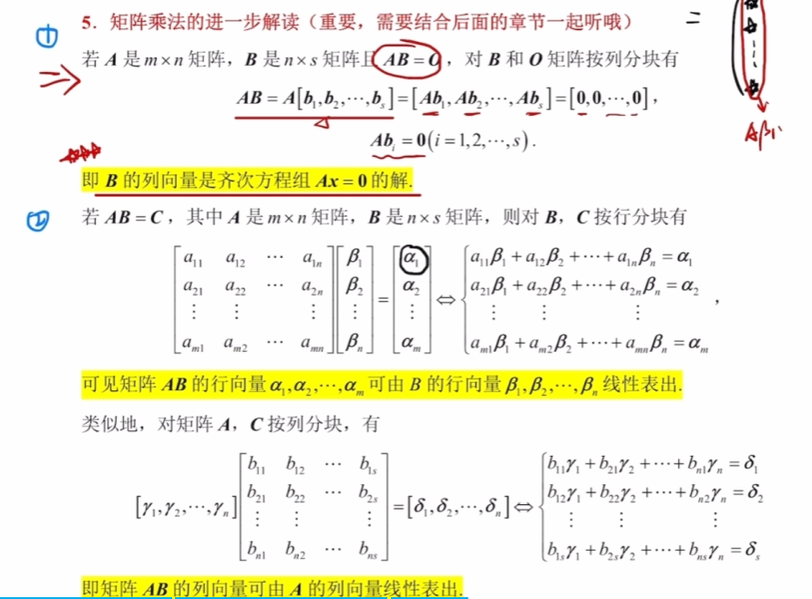
这里也可以看成是初等变换，$AB=C$，即$A$进行了一系列的列变换得到了$C$，当$B$可逆的情况下，那么$A$的列也可以由$C$的列线性表示
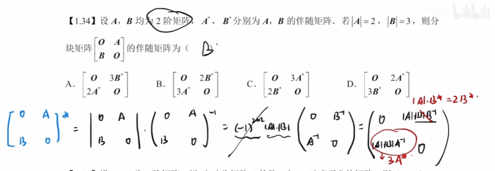

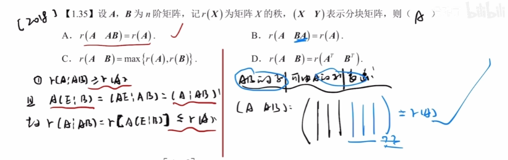

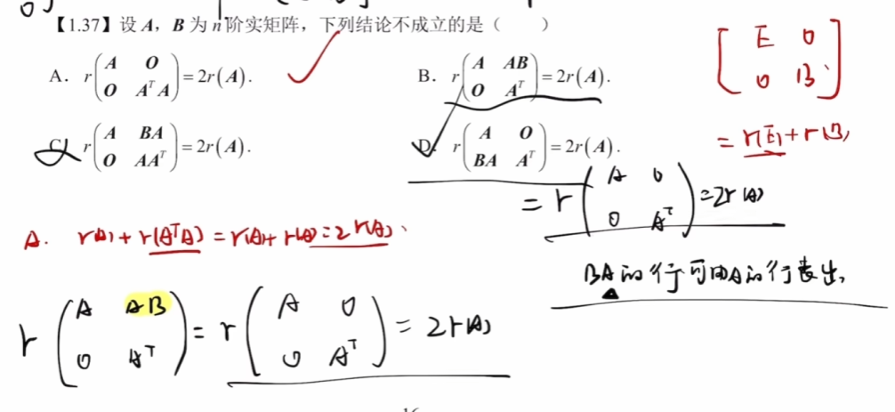
选项C要去消AB，需要列相等，但列变换是要右乘，得到的是AB不是BA
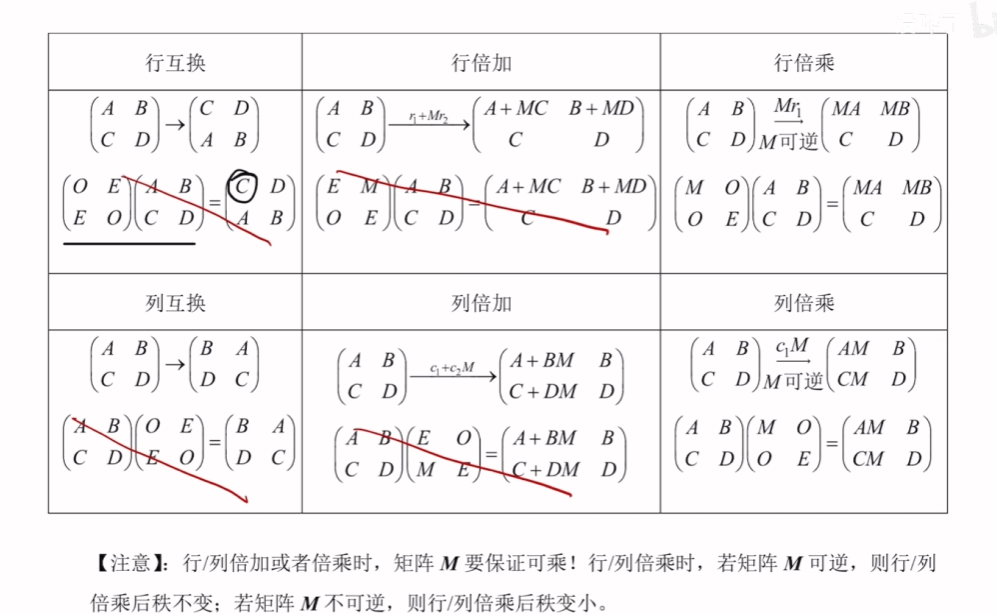

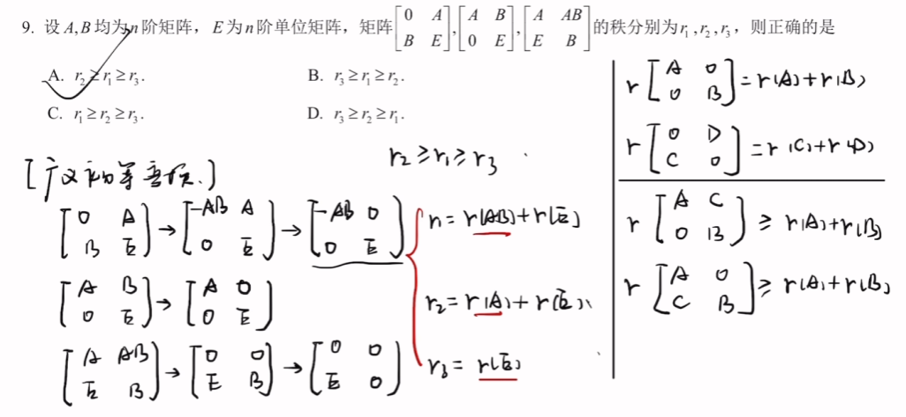
作消除操作的时候不要去消去$E$，因为题目基本上不说$A,B$是否可逆，可逆才可以这样去消除

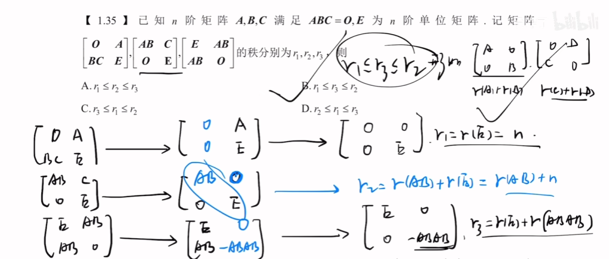
