## 二次型表示方法

含有 n 个变量 $x_1,x_2,\dots,x_n$的**二次齐次多项式**，叫做**二次型**

每一项的次数都是 **2 次**，没有常数项、一次项、三次及更高次项

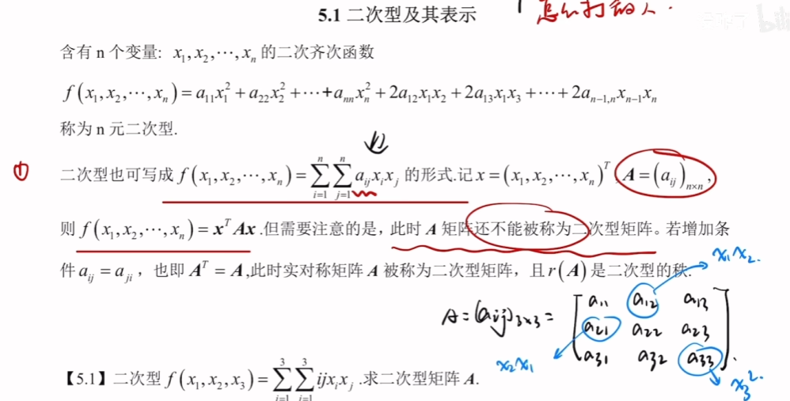

对函数来说$x_{1}x_{2}$的顺序没有区别，但是要使其称为二次型矩阵时需要对该系数除二

当不为实对称时，可以通过$\frac{A+A^{T}}{2}$将其调整为实对称矩阵

  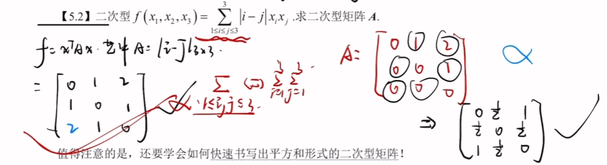

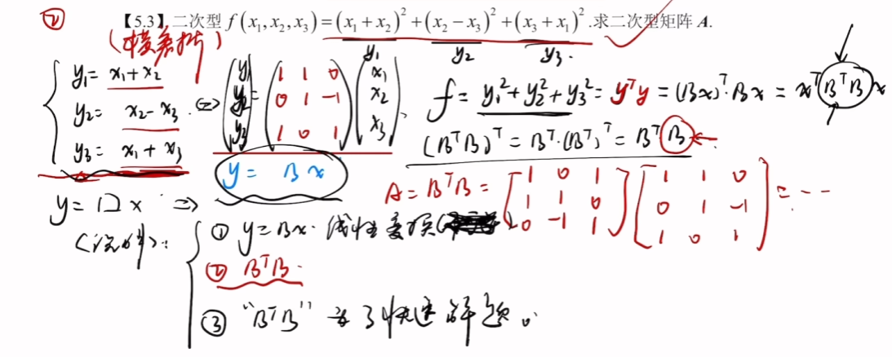
这里不可逆，不能看作是线性变换
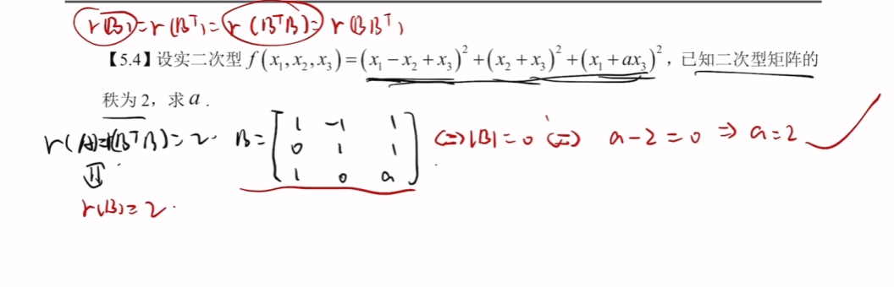

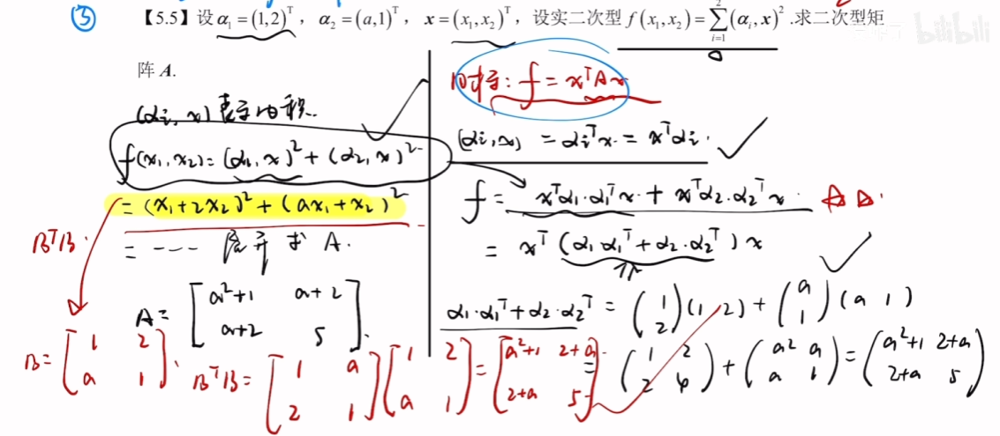

## 二次型的标准形、规范形

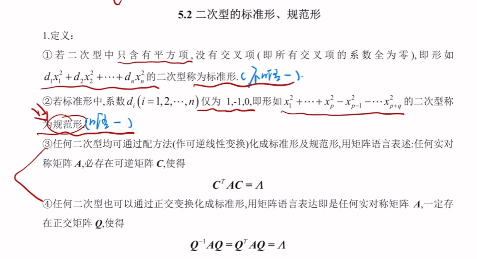

③过程称为合同变换，配方法得到的标准形和规范形不唯一，正交变换得到的标准形和规范形唯一
## 惯性定理
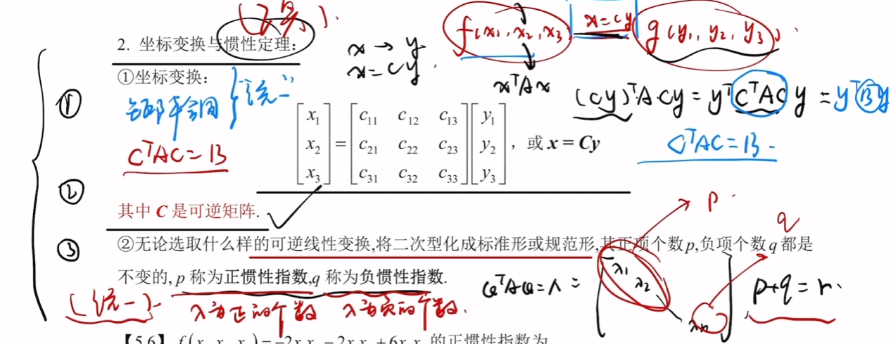

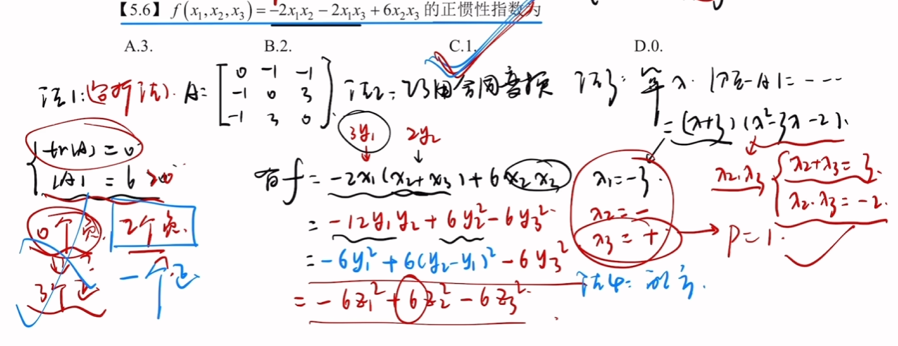
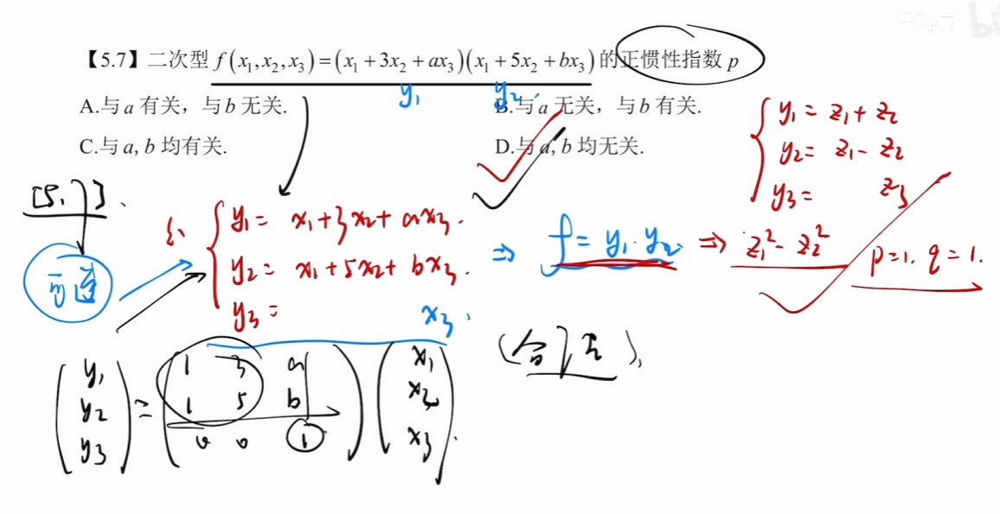

## 配方法

将有乘积的式子配成只含平方项的式子

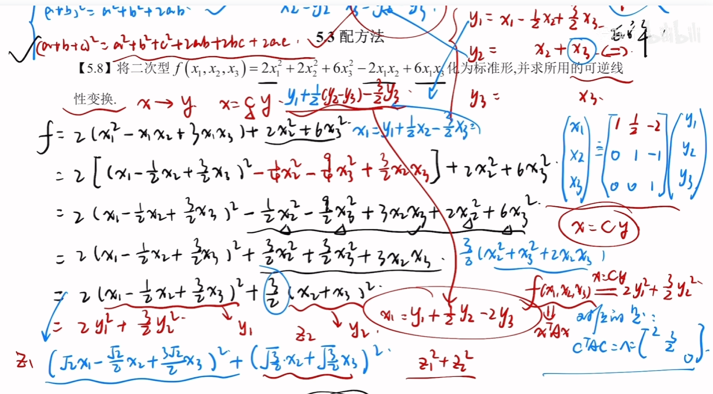
在这种情况下$y_{3}$对应的可以任意写，但是要保证矩阵可逆，照着写就完了

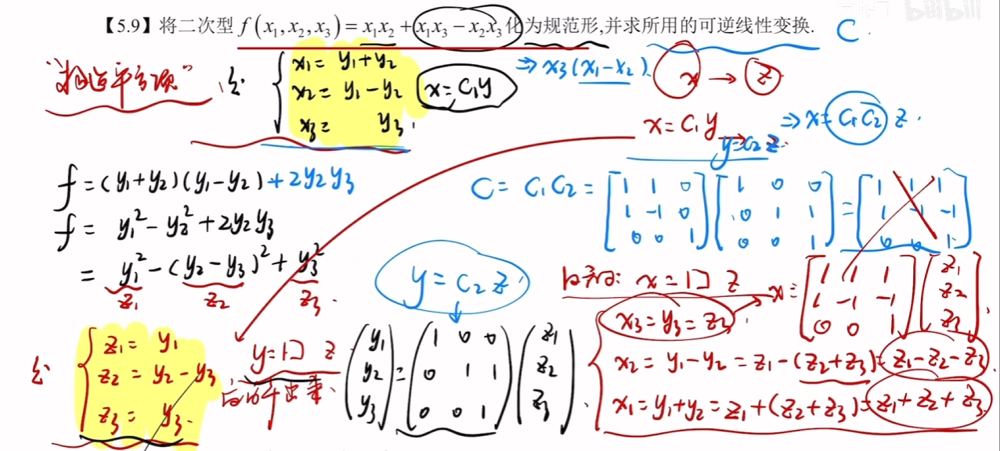
当不涉及两数平方项的时候，构造两数相加和两数相减来配方
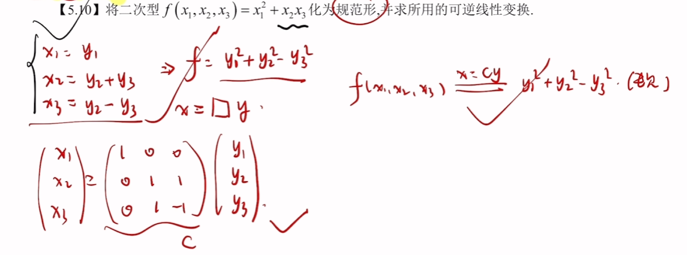
## 正交变换

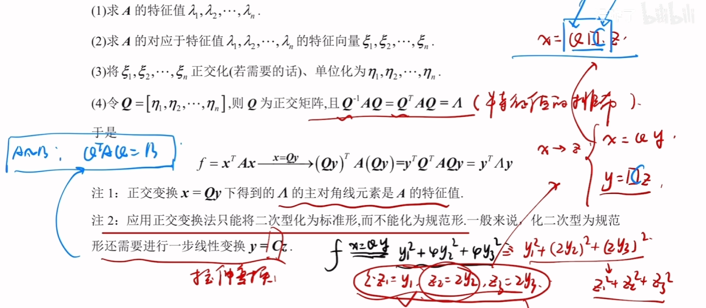

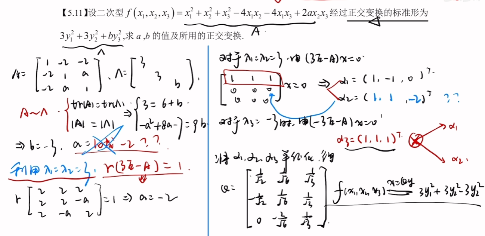

## 平方和二次型

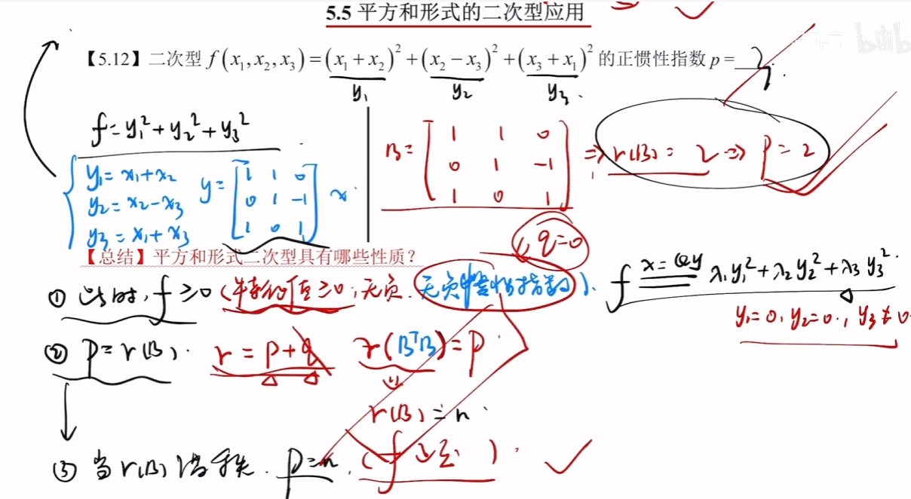

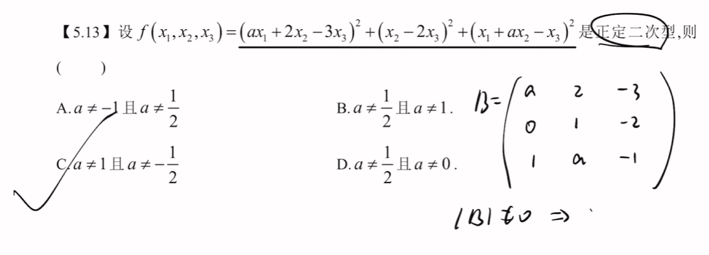

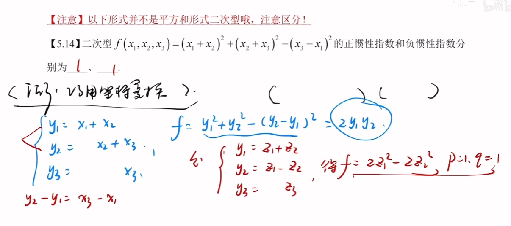

## 二次型等于0的求解

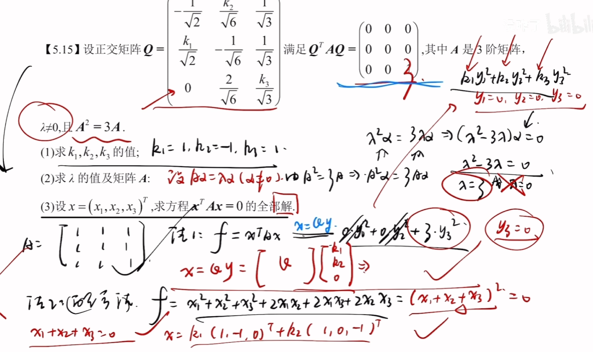

## 二次型化成另一个二次型

