## I/O控制方式

#### 程序查询方式和程序中断方式
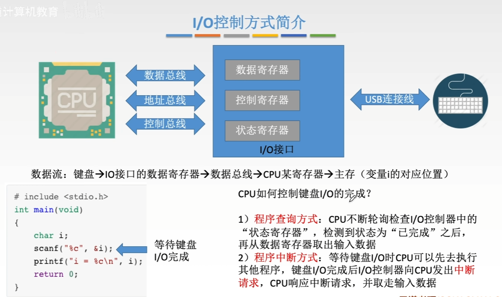

#### DMA控制方式
Direct Memory Access 直接内存访问

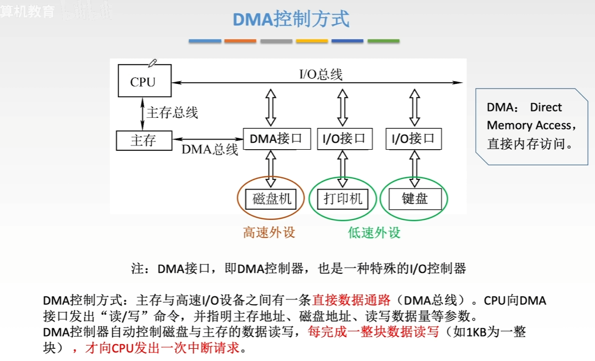
#### 通道控制方式

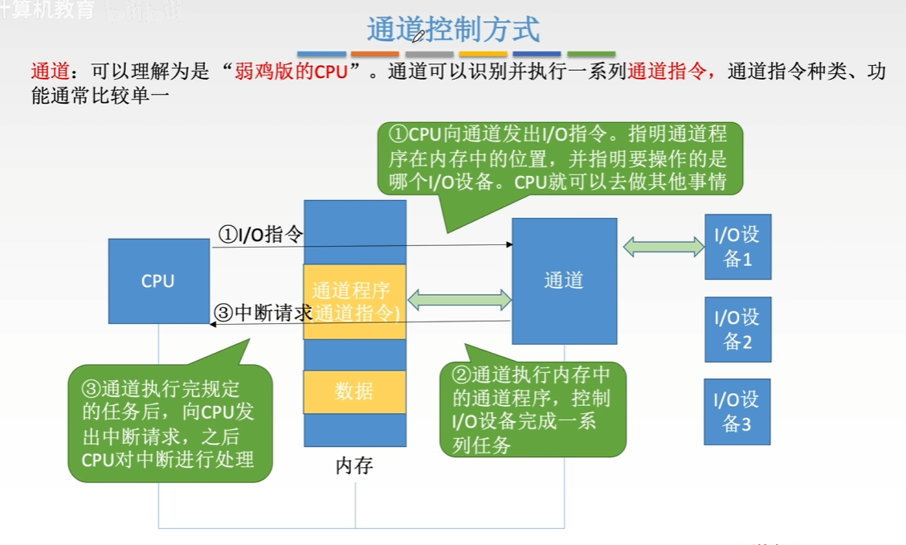

## I/O接口

又称I/O控制器、设备控制器，负责协调主机于外部设备之间的数据传输

### I/O接口的功能

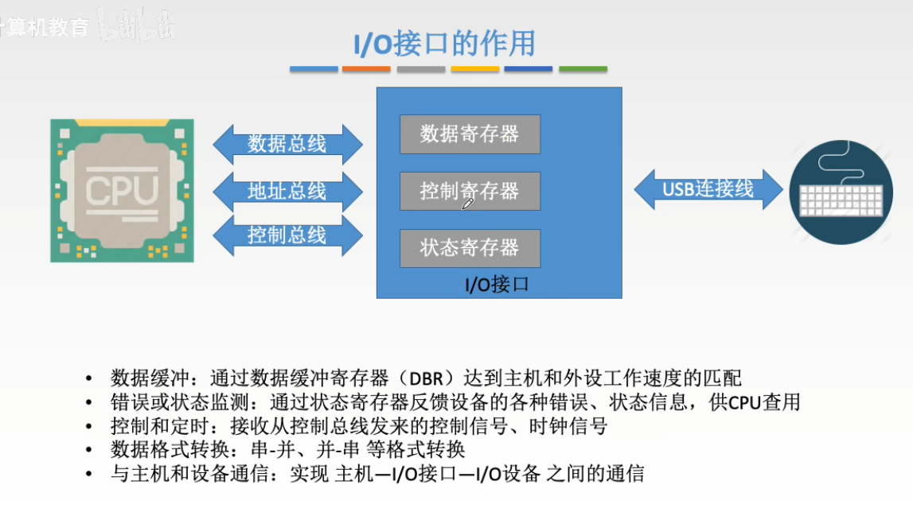

1. **进行地址译码和设备选择**：CPU 送来选择外设的地址码后，接口必须对地址进行译码以产生设备选择信息，使主机能和指定外设交换信息。
2. **实现主机和外设的通信联络控制**：解决主机与外设时序配合问题，协调不同工作速度的外设和主机之间交换信息，以保证整个计算机系统能统一、协调地工作。
3. **实现数据缓冲**：PU 与外设之间的速度往往不匹配，为消除速度差异，接口必须设置数据缓冲寄存器，用于数据的暂存，以避免因速度不一致而丢失数据。
4. **信号格式的转换**：外设与主机两者的电平、数据格式都可能存在差异，接口应提供主机与外设的信号格式的转换功能，如电平转换、并/串或串/并转换、模/数或数/模转换等。
5. **传送控制命令和状态信息**：CPU 要启动某外设时，通过接口中的命令寄存器向外设发出启动命令;外设准备就绪时，则将“准备好”状态信息送回接口中的状态寄存器，并反馈给 CPU。外设向 CPU 提出中断请求时，CPU 也应有相应的响应信号反馈给外设。

### I/O接口的基本结构

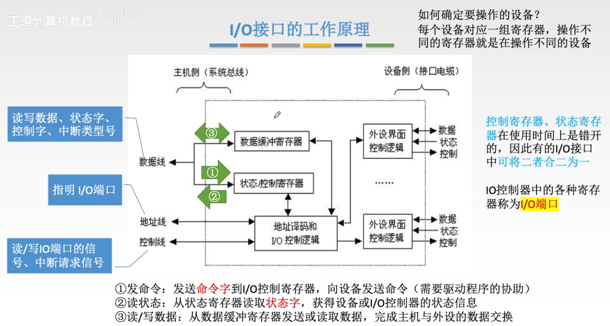

I/O端口是指接口电路中可以被CPU直接访问的寄存器

- 数据缓冲寄存器用来暂存与CPU或内存之间传送的数据信息；
- 状态寄存器用来记录接口和设备的状态信息；
- 控制寄存器用来保存CPU对外设的控制信息；
- 状态寄存器和控制寄存器在传送方向上是相反的，在访问时间上也是错开的，因此可将它们合二为一。

|      |     |
| ---- | --- |
| 数据端口 | 读&写 |
| 控制端口 | 写   |
| 状态端口 | 读   |

### I/O接口类型

按数据传输方式分：

1. 并行接口：一字节或一个字的所有位同时传送
2. 串行接口：一位一位地有序传送

> 接⼝要完成数据格式的转换
> 这⾥的数据传送⽅式是指外设和接⼝⼀侧的传送⽅式

按主机访问I/O设备的控制方式分：

1. 程序查询接口
2. 中断接口
3. DMA接口

按功能选择的灵活性分：

1. 可编程接口
2. 不可编程接口

### I/O端口及其编址

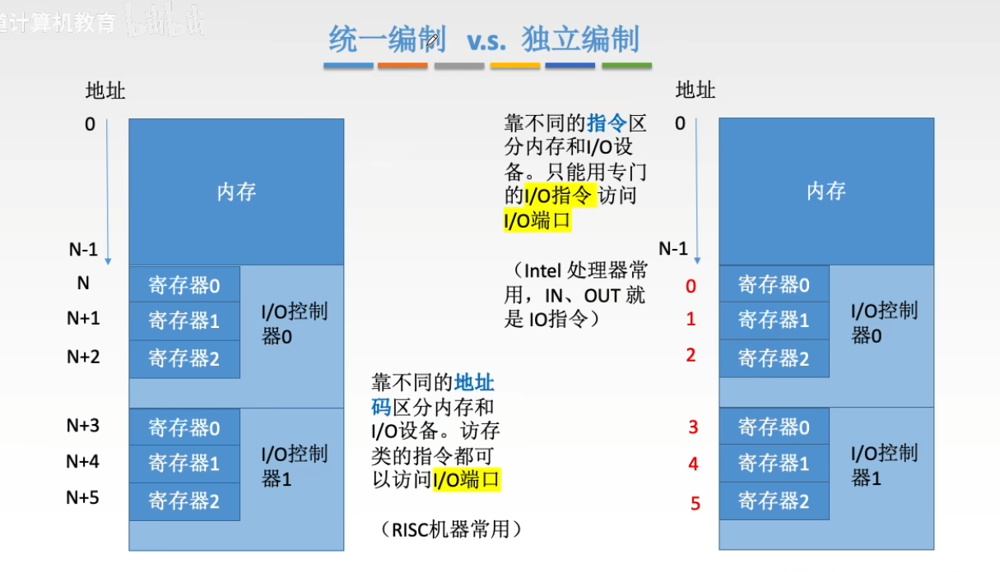
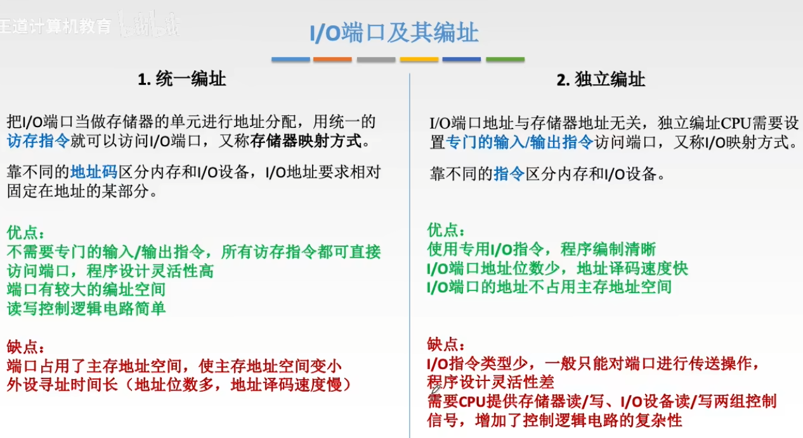

## I/O方式

### 程序查询方式

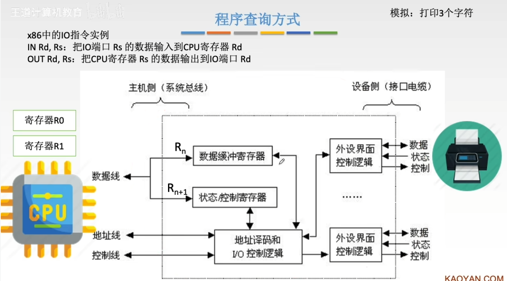

过程：

传递打印相关指令
1. 先将相关信息放到CPU寄存器中
2. CPU通过控制端口向控制线发出信息，表明这是一次写操作，并通过数据端口将打印指令放到控制寄存器中
3. I/O控制逻辑读取控制寄存器的内容后，向外部设备发出打印指令，等待返回ready后将状态放入状态寄存器中
4. CPU通过控制端口向控制线发出信息，表明这是一次读操作，并通过数据端口读取状态寄存器的相关信息，

在程序查询方式中，CPU发出打印指令后会不断将状态寄存器当中的内容读入CPU，来判断是否完成的准备工作

打印字符阶段

1. CPU通过控制端口向控制线发出信息，表明这是一次写操作，通过数据端口将打印的字符放到数据缓冲寄存器中，并通过地址端口向I/O控制逻辑指明数据放到哪个寄存器当中
2. I/O控制逻辑通过读取数据缓冲寄存器中的字符，发送给外部设备完成打印任务，并将相应状态放到状态寄存器当中
3. CPU通过控制端口向控制线发出信息，表明这是一次读操作，并通过数据端口读取状态寄存器的相关信息，

在程序查询方式中，CPU发出打印指令后会不断将状态寄存器当中的内容读入CPU，来判断是否完成了打印工作

设备停机阶段

参照传递打印指令的相关流程，只是将打印指令改为了停机指令

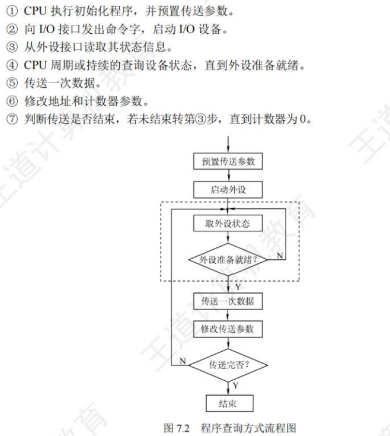

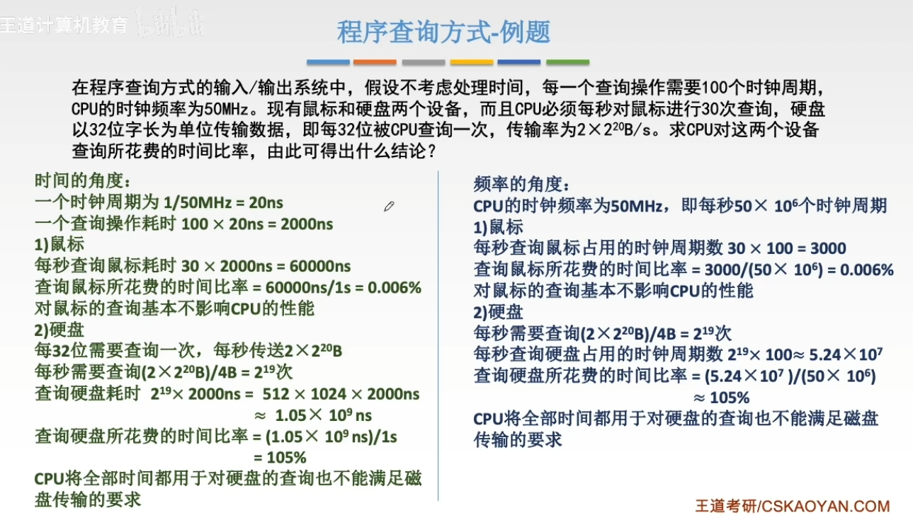
由于查询方式的不同可分为两种：

1. 独占查询：一旦设备被启动，CPU 就一直持续查询接口状态，CPU花费100%的时间用于 I/O 操作，此时外设和 CPU 完全串行工作。
2. 定时查询：CPU周期性地查询接口状态，每次总是等到条件满足才进行一个数据的传送，传送完成后返回到用户程序。定时查询的时间间隔与设备的数据传输速率有关。

优点：是设计简单、硬件量少。

缺点：是 CPU 要花费很多时间来查询和等待，且在一段时间内只能和一台外设交换信息，CPU与设备串行工作，效率很低。

### 程序中断方式

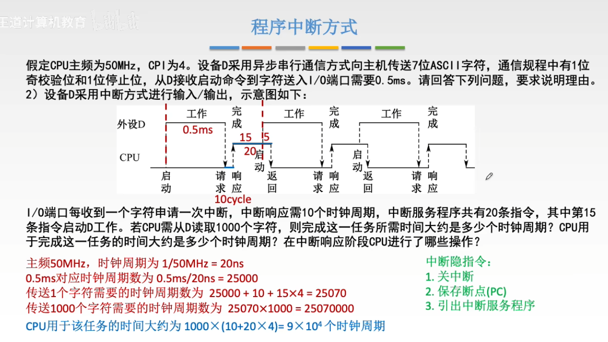
> 这个中断指的是让CPU停下手上正在做的事，来响应这个请求
#### 单重中断

执行中断服务程序时不响应新的中断请求

中断处理过程为:1关中断;2.保存断点;3.识别中断源;4.保存现场;5.中断事件处理;6.恢复现场;7.开中断;8.中断返回。
##### 中断概念

程序中断是指在计算机执行现行程序的过程中，出现某些急需处理的异常情况或特殊请求，CPU暂时中止现行程序，而转去对这些异常情况或特殊请求进行处理，在处理完毕后CPU又自动返回到现行程序的断点处，继续执行原程序。

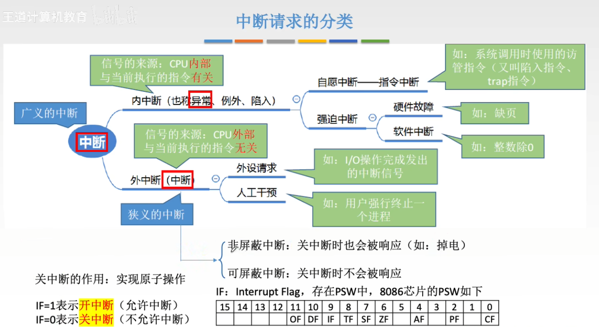

##### 处理中断过程

工作流程：

①中断请求
②中断响应判优
③判断是否满足CPU响应中断的条件
④中断响应过程
⑤中断向量
⑥中断处理过程

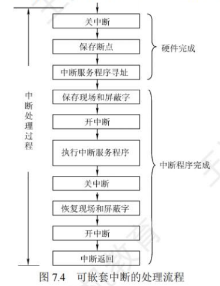
硬件完成部分为中断隐藏指令

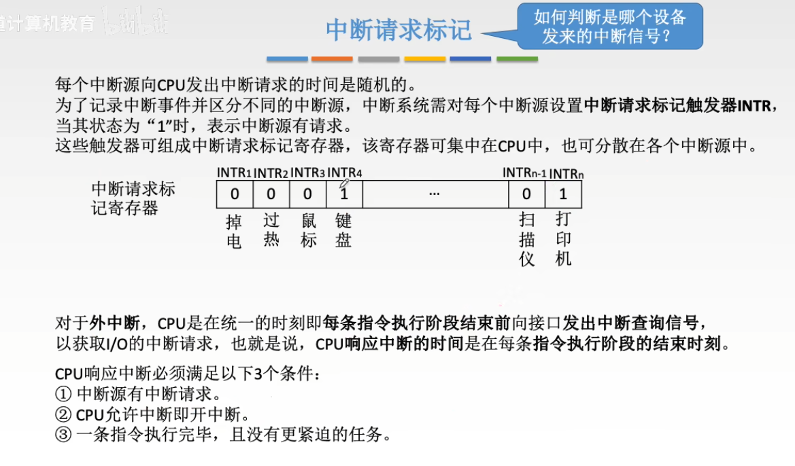

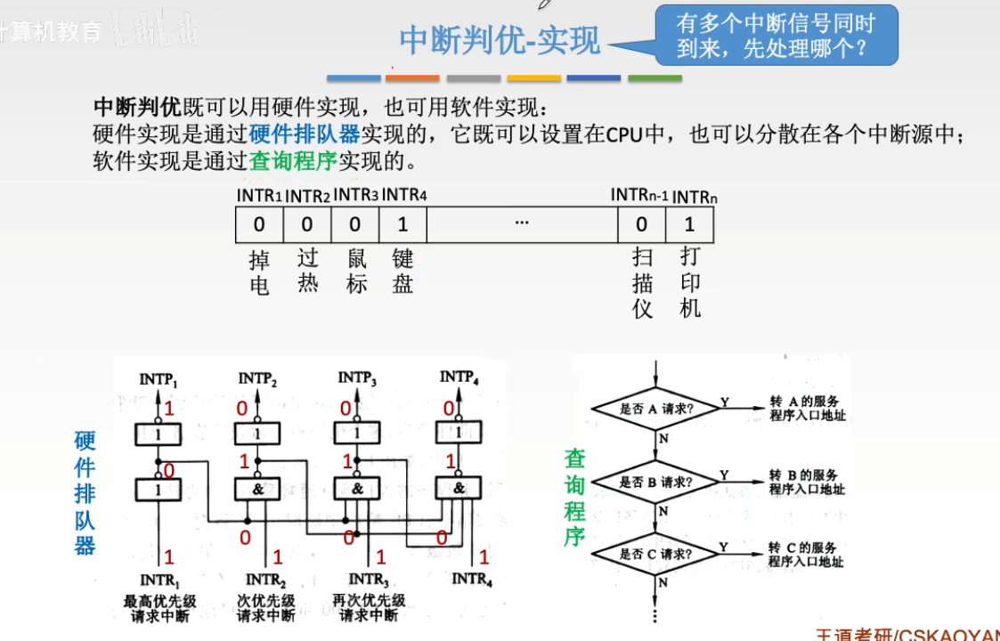
中断响应优先级由硬件确定，中断处理优先级由软件设定中断屏蔽字来确定，屏蔽自身和低优先级的

中断隐指令：保存原程序的PC值，并让PC指向中断服务程序的第一条指令

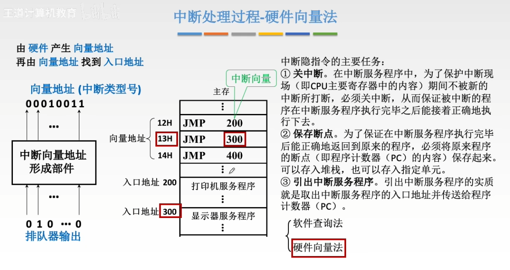
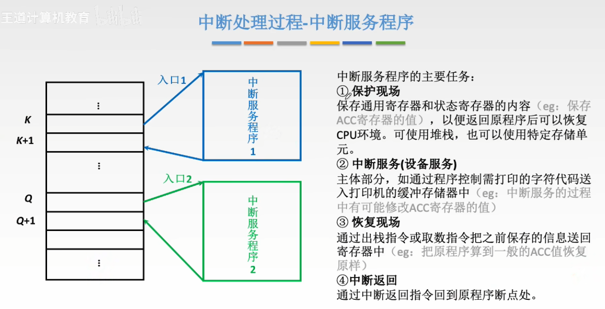

#### 多重中断

又称中断嵌套，执行中断服务程序时响应新的中断请求，

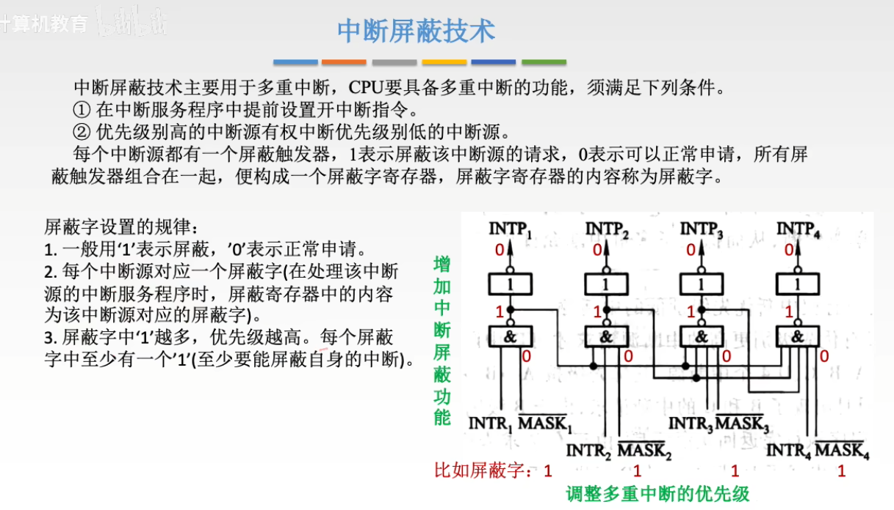

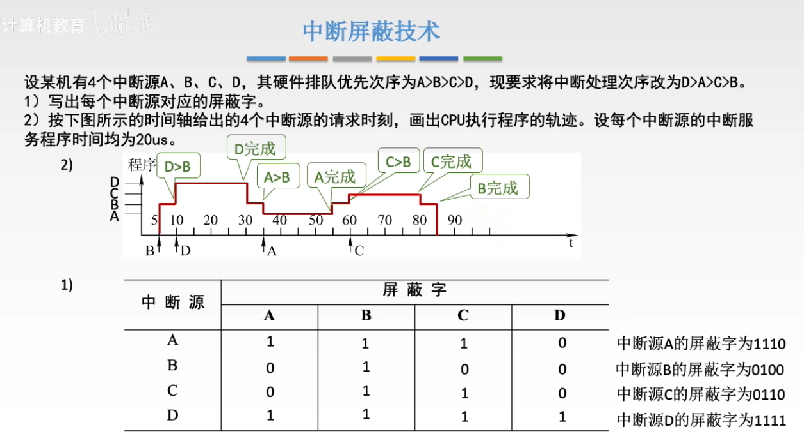

多重中断条件：

①在中断服务程序中提前设置开中断指令。
②优先级别高的中断源有权中断优先级别低的中断源。

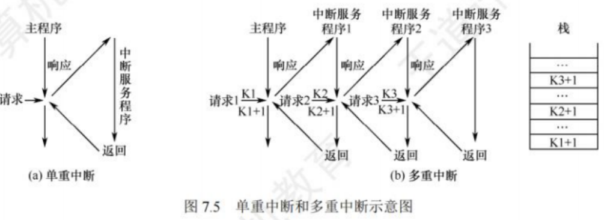

### DMA方式

DMA 方式是一种完全由硬件进行成组信息传送的控制方式，它具有程序中断方式的优点，即在数据准备阶段，CPU 与外设并行工作。DMA 方式在外设与内存之间开辟了一条“直接数据通路”，信息传送不再经过 CPU，降低了 CPU 在传送数据时的开销，因此称为直接存储器存取方式。由于数据传送不经过 CPU，因此不需要保护、恢复 CPU 现场等烦琐操作。

这种方式适用于磁盘、显卡、声卡、网卡等高速设备大批量数据的传送，它的硬件开销比较大。在 DMA 方式中，中断的作用仅限于故障和正常传送结束时的处理。

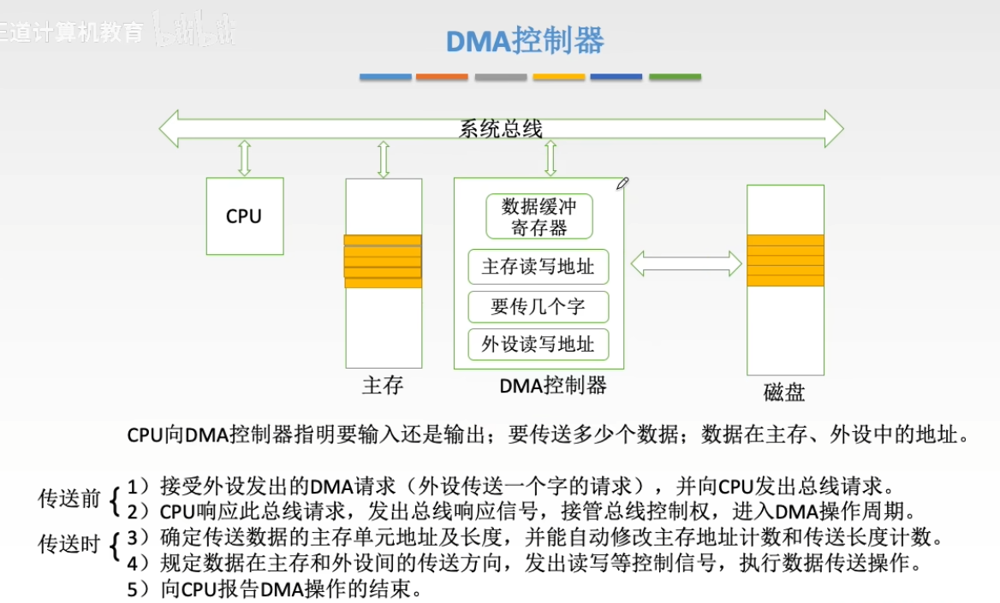

DMAC又叫DMA控制器，是对数据传送过程进行控制的硬件，在DMA传送过程中，DMAC将接管CPU的地址总线、数据总线和控制总线，CPU的主存控制信号被禁用

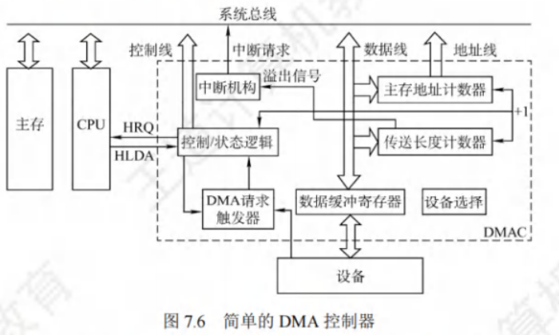

单总线是CPU说了算，三总线的情况需要进行访存处理

#### DMA的传送方式

避免DMA和CPU同时访问主存
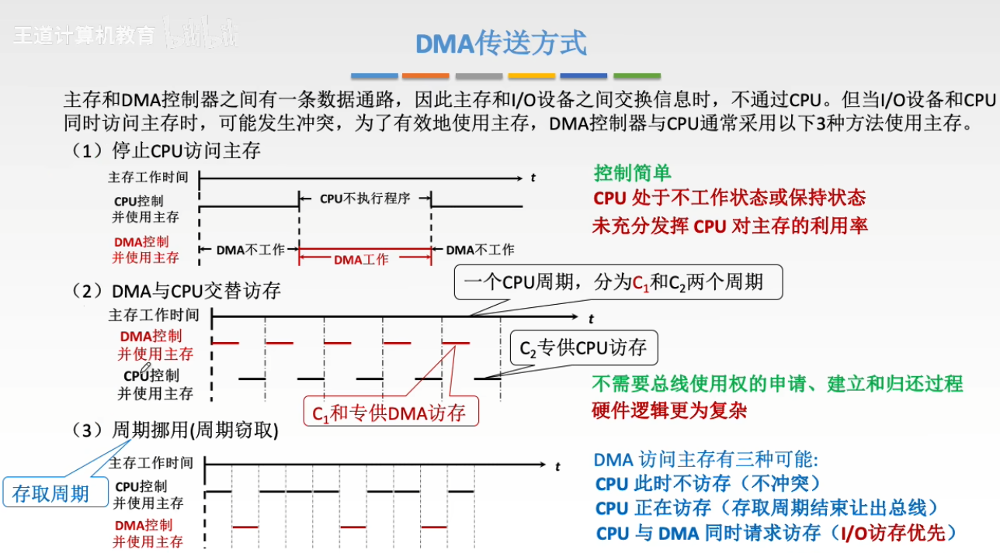
周期挪用：高速I/O设备有高优先级的访存，将DMA的时间向前挪用

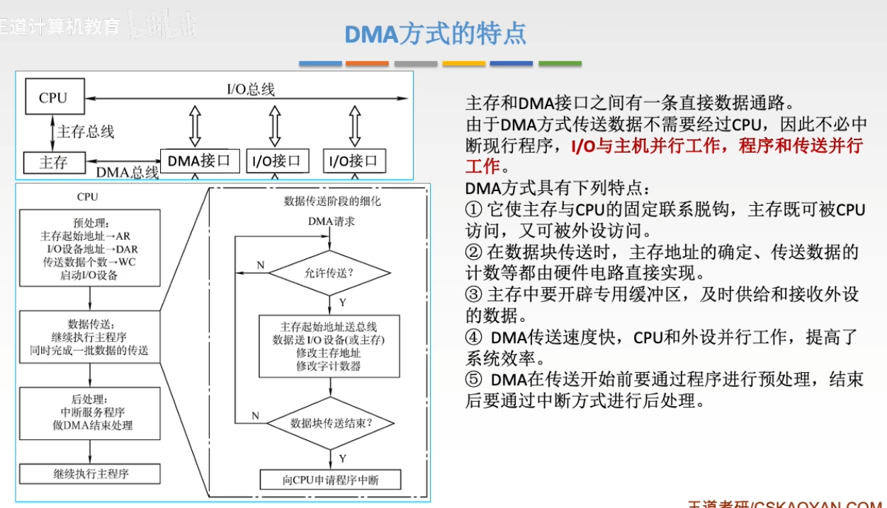

