## 总线概述

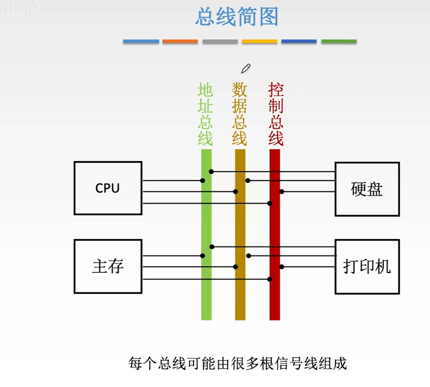
设机器字长为32bit，则一个总线里面有三十二根线来分别传递三十二位二进制信息
### 总线基本概念

总线：总线是一组能为多个部件**分时**和**共享**的公共信息传送线路。同一时刻只能有一个部件发送数据，可以有多个部件接收

总线特性：
- 机械特性：尺寸、形状、管脚数、排列顺序
- 电气特性：传输方向和有效的电平范围
- 功能特性：每根传输线的功能(地址、数据、控制)
- 时间特性：信号的时序关系

分时性：任一时刻仅允许一个部件向总线发送信息，多个发送方需要分时使用总线。
共享性：多个部件可同时挂接在总线上，并能同时接收总线上传输的信息。
### 总线的分类

分为串行总线和并行总线

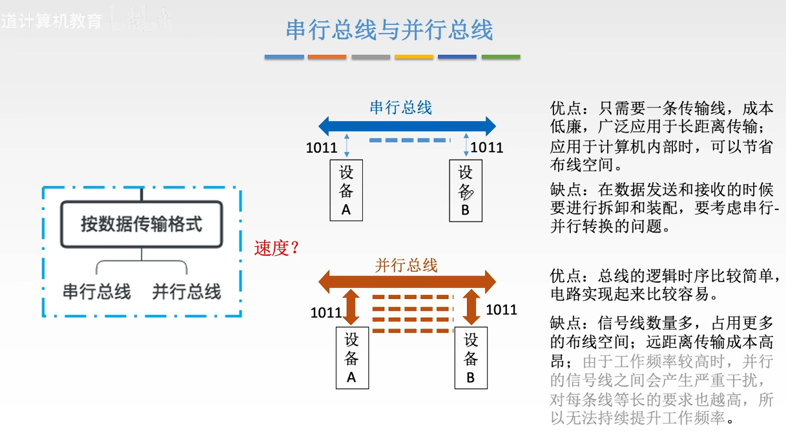
#### 按总线的功能分

##### 片内总线

也称内部总线，是芯片内部的总线，是CPU芯片内部寄存器与寄存器之间，寄存器与ALU之间的公共连接线
##### 系统总线
是计算机系统内各功能部件之间相互连接的总线，根据总线传输信息内容不同可分为数据总线、地址总线和控制总线
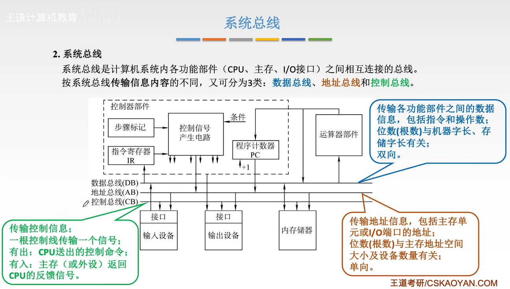
##### 通信总线
用于计算机系统之间或计算机系统与其他系统之间信息传送的总线，也称为外部总线
#### 按时序控制方式分

分为同步总线和异步总线

### 系统总线的结构

#### 单总线结构

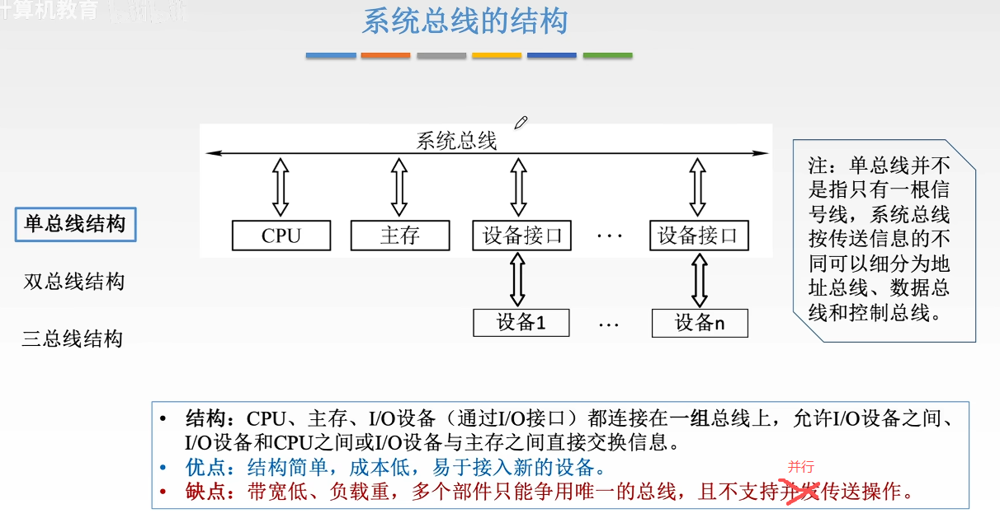
#### 双总线结构

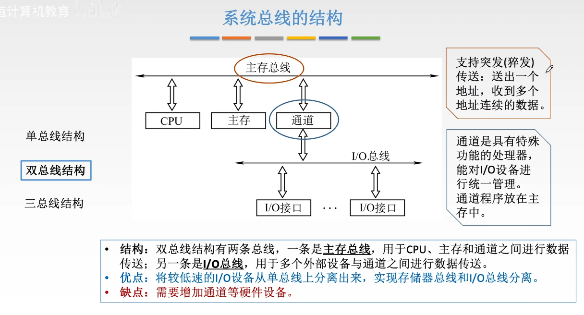
#### 三总线结构

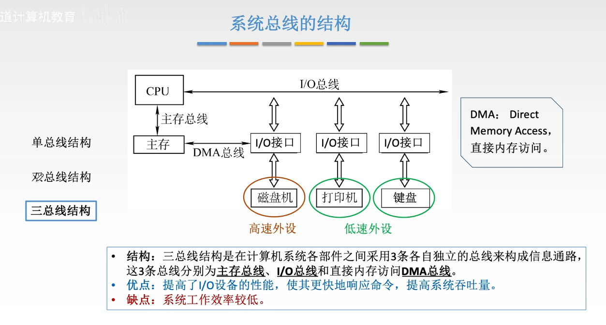
#### 四总线结构

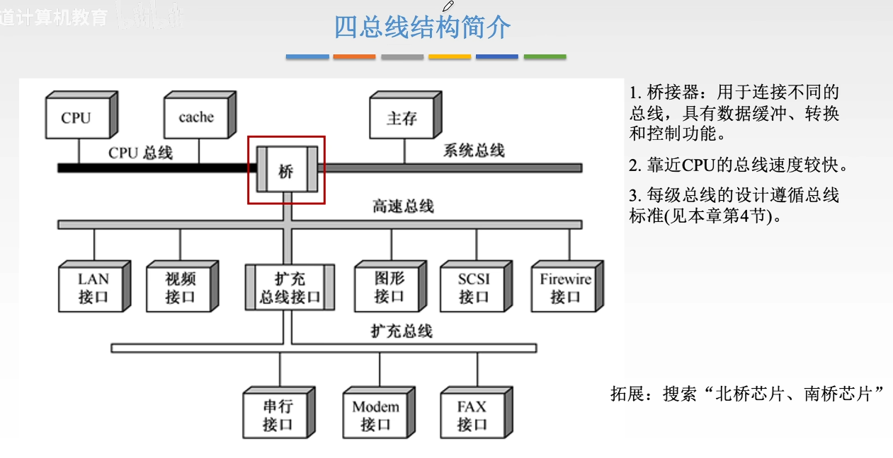

#### 南北桥结构

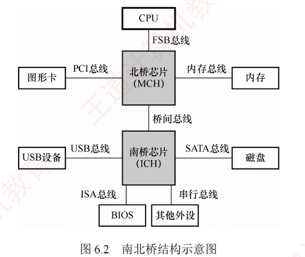
- 北桥芯片(Memory Controller Hub，MCH)作为高速枢纽，连接CPU、主存和显卡，负责高带宽数据传输。
- 南桥芯片(I/O Controller Hub，ICH)是一个I/O控制器集线器，负责管理USB、SATA、以太网等低速I/O接口，并提供扩展槽支持。

CPU与北桥之间的互连通道称为前端总线(Front Side Bus，FSB)，也称系统总线

#### 现代集成化总线结构

将北桥芯片的核心功能集成到CPU内部，系统互联方式转向片上集成与点对点互连

使得内存访问路径缩短
处理器间高速互连
I/O通路直连
### 总线的性能指标

区别于之前的机器周期与时钟周期

CPU 发出地址 → 发出读命令 → 内存返回数据为一个总线周期
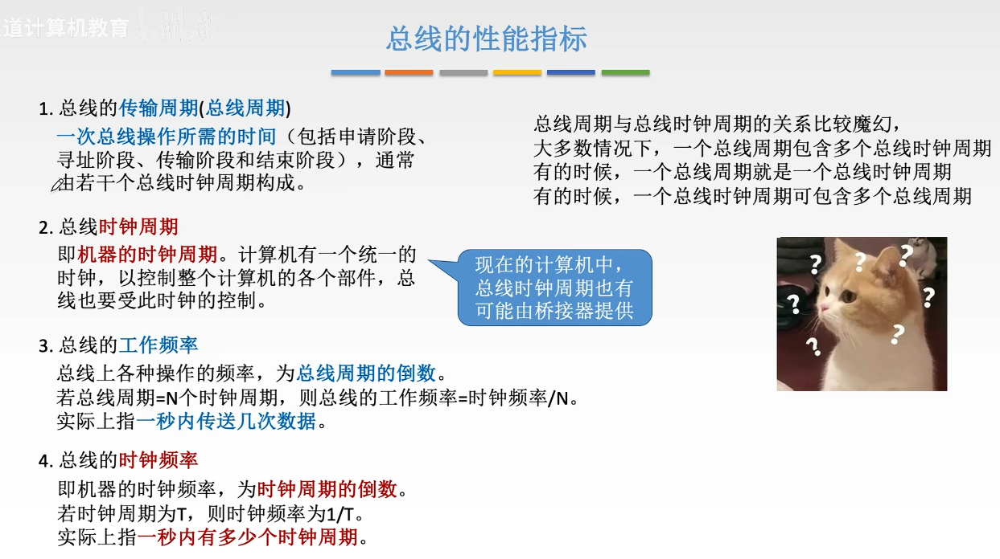
总线时钟频率：一秒有多少个总线时钟周期，即一秒将多少个总线宽度的数据进行传输
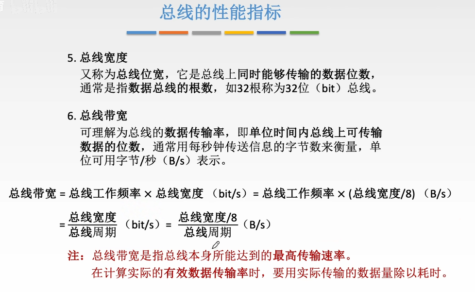

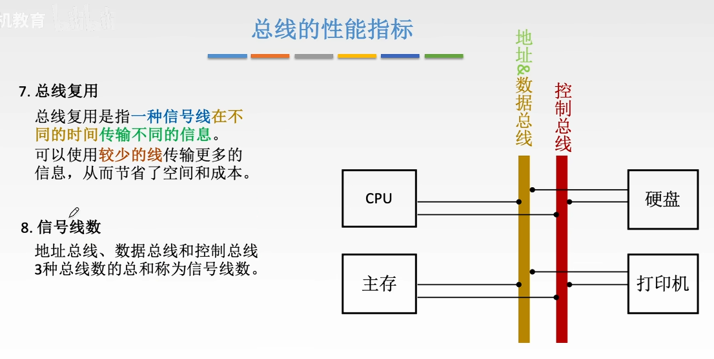

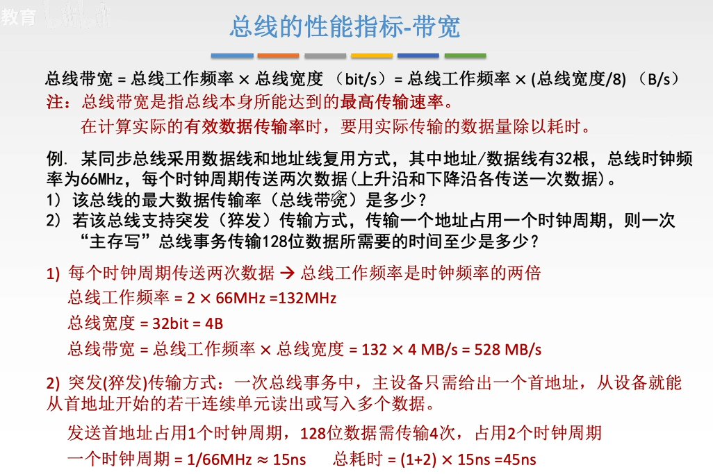

## 总线仲裁 不考，了解

多个主设备同时竞争主线控制权，以某种方式选择一个主设备有限获得总线控制权，具体分为： 
- 集中仲裁方式：链式仲裁方式、计数器定时查询方式、独立请求方式
- 分布仲裁方式
### 集中仲裁方式
#### 链式查询方式

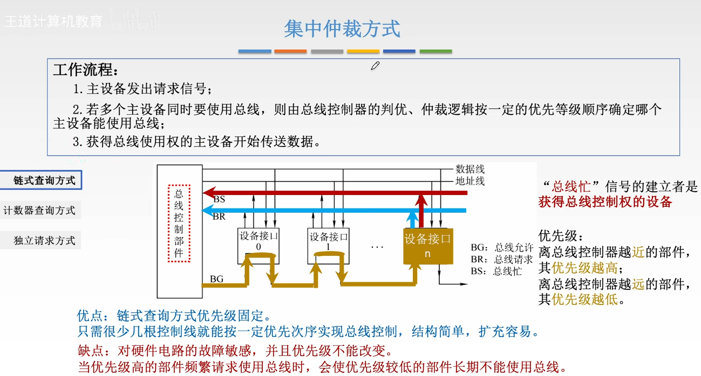

#### 计数器查询方式

#### 独立请求方式

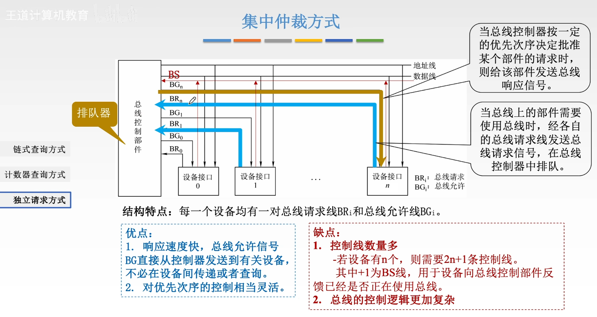

### 分布式总裁方式

不需要中央仲裁器，每个潜在的主模块都有自己的仲裁器和仲裁号，多个仲裁器竞争使用总线。

- 当设备有总线请求时，主模块就把各自唯一的仲裁号发送到共享的仲裁总线上；
- 每个仲裁器将从仲裁总线上得到的仲裁号与自己的仲裁号进行比较；
- 如果仲裁总线上的号优先级高于自身的仲裁号，则该主模块的总线请求不予响应，并撤销该主模块的仲裁号；
- 最后，获胜者的仲裁号保留在仲裁总线上。
## 总线的操作和定时

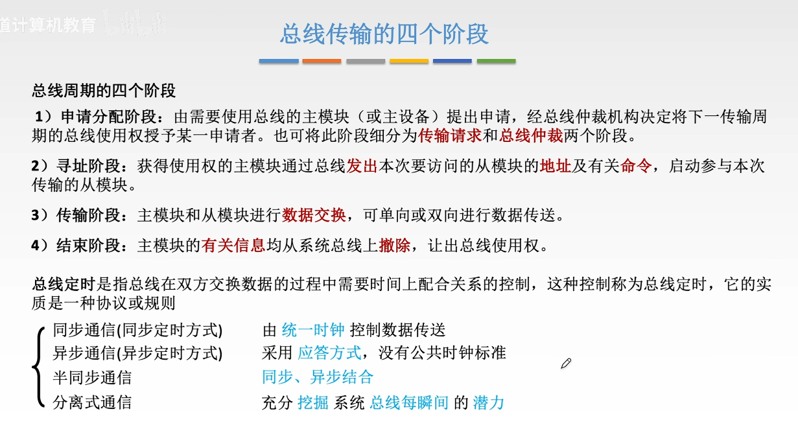

### 同步通信 同步定时方式

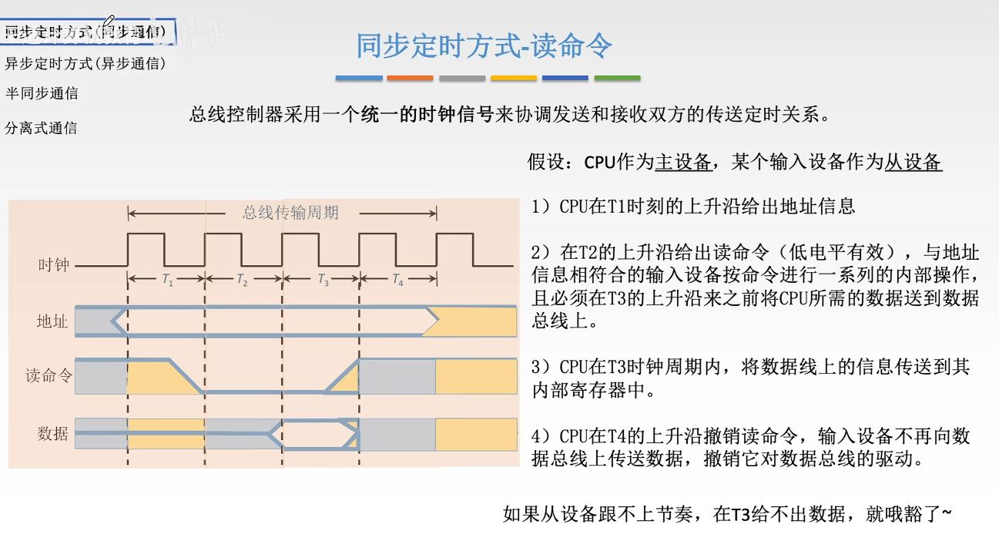

若干个时钟产生相等的时间间隔，每个间隔构成一个总线周期。在一个总线周期中，发送方和接收方可进行一次数据传送。

因为采用统一的时钟，每个部件或设备发送或接收信息都在固定的总线传送周期中，一个总线的传送周期结束，下一个总线传送周期开始。

优点:传送速度快，具有较高的传输速率；总线控制逻辑简单。

缺点:主从设备属于强制性同步;不能及时进行数据通信的有效性检验，可靠性较差。

同步通信适用于总线长度较短及总线所接部件的存取时间比较接近的系统。
### 异步通信 异步定时方式

没有统一的时钟和固定的时间间隔，完全依靠传送双方相互制约的握手型号实现定时控制

根据请求和回答信号的撤销与否可分为不互锁方式，半互锁方式和全互锁方式
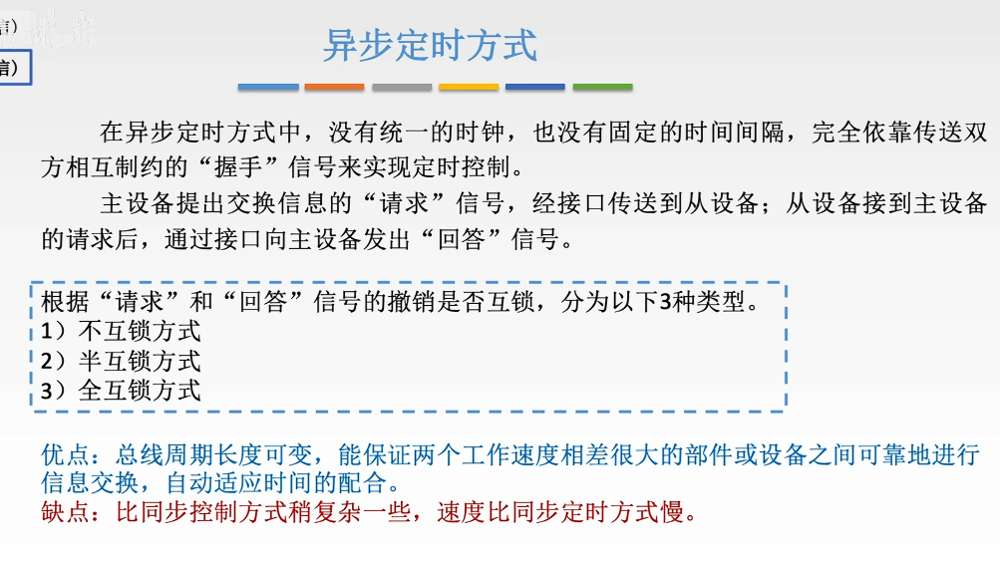

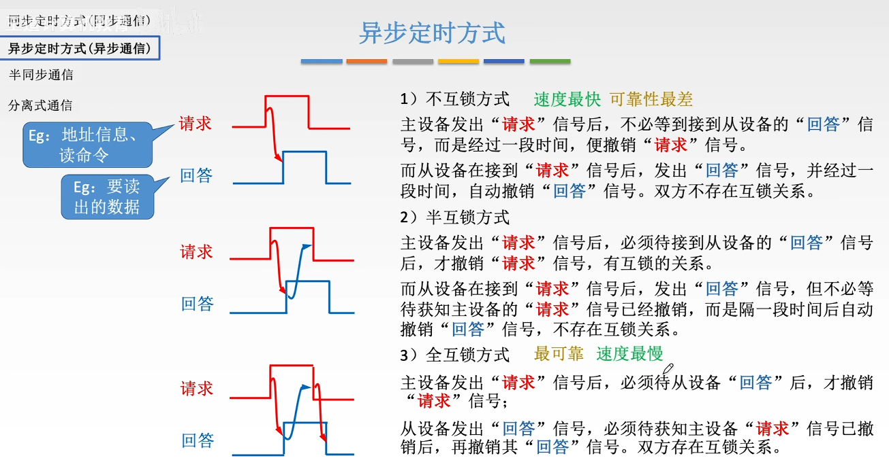
### 半同步通信
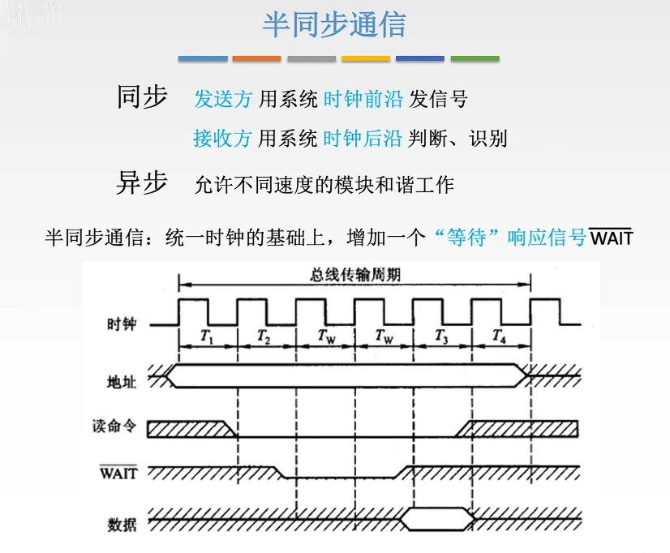

### 分离式通信

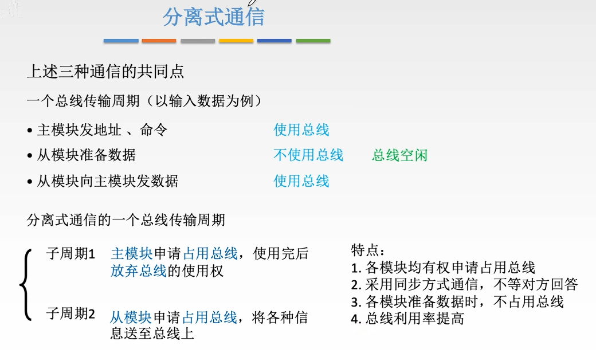

## 总线事务和定时

### 总线事务

1. 请求阶段：主设备(CPU或DMA)发出总线传输请求，并且获得总线控制权。
2. 仲裁阶段：总线仲裁机构决定将下一个传输周期的总线使用权授予某个申请者。
3. 寻址阶段：主设备通过总线给出要访问的从设备地址及有关命令，启动从模块。
4. 传输阶段：主模块和从模块进行数据交换，可单向或双向进行数据传送。
5. 释放阶段：主模块的有关信息均从系统总线上撤除，让出总线使用权。

总线上的数据传送方式分为非突发方式和突发方式两种。非突发传送方式在每个传送周期内都先传送地址，再传送数据，主、从设备之间通常每次只能传输一个字长的数据。

突发(猝发)传送方式能够进行连续成组数据的传送，其寻址阶段发送的是连续数据单元的首地址，在传输阶段传送多个连续单元的数据，每个时钟周期可以传送一个字长的信息，但是不释放总线，直到一组数据全部传送完毕后，再释放总线。

### 总线定时

总线定时是指总线在双方交换数据的过程中需要时间上配合关系的控制，这种控制称为总线定时，其实质是一种协议或规则，主要有同步、异步、半同步和分离式四种定时方式。

1. **同步定时**：
    &nbsp;&nbsp;&nbsp;&nbsp;指系统采用一个统一的时钟信号来协调发送和接收双方的传送定时关系。时钟产生相等的时间间隔，每个间隔构成一个总线周期。在一个总线周期中，发送方和接收方可以进行一次数据传送。因为采用统一的时钟，每个部件或设备发送或接收信息都在固定的总线传送周期中，一个总线的传送周期结束，下一个总线的传送周期开始。

    优点:
    &nbsp;&nbsp;&nbsp;&nbsp;传送速度快，具有较高的传输速率;总线控制逻辑简单。
    缺点:
    &nbsp;&nbsp;&nbsp;&nbsp;主从设备属于强制性同步;不能及时进行数据通信的有效性检验，可靠性较差。

    &nbsp;&nbsp;&nbsp;&nbsp;同步通信适用于总线长度较短及总线所接部件的存取时间比较接近的系统。同步串行通信方式是发送方时钟直接控制接收方时钟，使双方完全同步的一种逐位传输的通信方式。使用同步串行通信时，由于收发双方的时钟严格一致，因此仅在数据块的头尾处添加了开始和结束标记，传输效率较高，但实现的硬件设备也更复杂，所以较少采用。
2. **异步定时**：
    &nbsp;&nbsp;&nbsp;&nbsp;在异步定时方式中，没有统一的时钟，也没有固定的时间间隔，完全依靠传送双方相互制约的“握手”信号来实现定时控制。通常，主设备提出交换信息的“请求”信号，经接口传送到从设备：从设备接到主设备的请求后，通过接口向主设备发出“回答”信号。
    优点:
    &nbsp;&nbsp;&nbsp;&nbsp;总线周期长度可变，能保证两个工作速度相差很大的部件或设备之间可靠地进行信息交换，自动适应时间的配合。
    缺点:
    &nbsp;&nbsp;&nbsp;&nbsp;比同步控制方式稍复杂一些，速度比同步定时方式慢。

    不互锁方式：
        &nbsp;&nbsp;&nbsp;&nbsp;主设备发出“请求”信号后，不必等到接到从设备的“回答”信号，而是经过一段时间便撤销“请求”信号。而从设备在接到“请求”信号后，发出“回答”信号，并经过一段时间后自动撤销“回答”信号。
    半互锁方式：
        &nbsp;&nbsp;&nbsp;&nbsp;主设备发出“请求”信号后，必须在接到从设备的“回答”信号后，才撤销“请求”信号，有互锁的关系。而从设备在接到“请求”信号后，发出“回答”信号,但不必等待获知主设备的“请求”信号已经撤销，而是隔一段时间后自动撤销“回答”信号，不存在互锁关系。
    全互锁方式：
        &nbsp;&nbsp;&nbsp;&nbsp;主设备发出“请求”信号后，必须在从设备“回答”后才撤销“请求”信号:从设备发出“回答”信号后，必须在获知主设备“请求”信号已撤销后，再撤销其“回答”信号。
        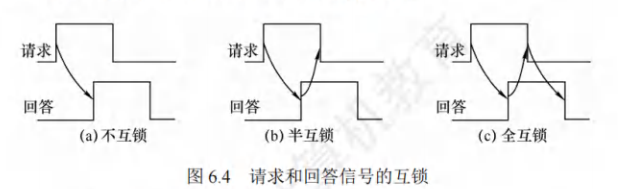
3. **半同步定时**：
   数据发出时间严格参照系统时钟的某个前沿开始，而接收方都采用系统时钟后燕时刻来进行判断识别；同时允许不同速度的设备和谐地工作
   优点：
   &nbsp;&nbsp;&nbsp;&nbsp;控制方式比异步定时简单，各模块在系统时钟的控制下同步工作。
   缺点：
    &nbsp;&nbsp;&nbsp;&nbsp;系统时钟的频率不能要求太高，因此系统工作的速度不快。
4. **分离式定时**
    讲总线事务分解为请求和应答两个子过程。请求过程中，主设备A通过总线向设备B发送命令、地址；应答过程中设备B通过总线向总设备A发送相应的数据。两个过程都只有单方向的信息流，每个设备都变为主设备。
    优点：
    &nbsp;&nbsp;&nbsp;&nbsp;在不传送数据时释放总线，使总线可接受其他设备的请求，不存在空闲等待时间；
    缺点：
    &nbsp;&nbsp;&nbsp;&nbsp;控制复杂，开销大。
| **同步定时/控制方式**                           | **异步定时/控制方式**                          |
|----------------------------------------------|----------------------------------------------|
| **定义**                                     | **定义**                                     |
| 由统一时序控制的通信方式  同步通信采用公共时钟，有统一的时钟周期，同步时钟信号不由各设备提供  同步控制既可用于CPU控制，又可用于高速的外部设备控制 | 没有统一的时钟；没有固定的时间间隔（不采用时钟信号，只采用握手）  完全依靠传送双方相互制约的“握手”信号来实现定时控制  传送操作是由双方按需求分配时间的  每次握手完成一次通信，但是一次通信往往交换多位数据 |
| **优点**                                     | **优点**                                     |
| 传送速度快，具有较高的传输速率  总线控制逻辑简单  同步通信不需要应答信息且总线长度短  同步通信用一个公共的时钟信号进行同步  同步通信中，各部件的存取时间较接近 | 总线周期长度可变  能保证两个工作速度相差很大的部件或设备之间可靠地进行信息交换  自动适应时间的配合 |
| **缺点**                                     | **缺点**                                     |
| 主从设备属于强制性同步  不能及时进行数据信道的有效性验证  可靠性较差 | 比同步稍复杂一些  速度比同步方式慢                        |
| **适用场合**                                 | **适用场合**                                 |
| 适用于总线长度较短及总线所接部件的存取时间比较接近的系统  采用同步控制也可以进行数据的传输，但不能发挥快速设备的高速性能 | 主要用于在不同的设备间进行通信                               |

